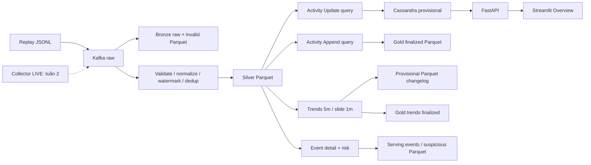

# Kiến trúc WikiPulse — core và producer W2

Query độc lập/checkpoint riêng để không ghép nhiều stateful operators trong Update mode. Bronze giữ raw payload; Silver privacy-safe. Invalid và canary không đi vào activity. Cassandra ghi absolute counts/khóa ổn định; retry không cộng đôi. Gold chỉ lưu cửa sổ qua watermark10m, độ trễ khác provisional.

Spark có 9 query/checkpoint độc lập: 5 query CP0 và 4 query analytics W2. Analytics mặc định Parquet; trends provisional là các snapshot tổng tuyệt đối theo batch, consumer lấy batch mới nhất theo khóa, không cộng các batch. Mode Cassandra W2 chỉ khởi động khi store của Nhân có đủ methods. API/UI hiện vẫn chỉ phục vụ activity; sơ đồ không ngụ ý API trends/risk đã hoàn thiện. Schema/công thức ở [contracts](contracts.md), chi tiết producer ở [processing README](../processing/README.md).

Docker core là local single-node, Spark local[2], 2 shuffle partitions, driver 1 GiB, Kafka heap 512 MiB, Cassandra heap 512 MiB. Dev stack có named volumes theo project. Full overlay thay filesystem của các tầng Parquet và 9 checkpoints bằng HDFS NameNode/DataNode đơn, replication 1, heap 256 MiB/node, hai named volumes bền qua recreate. Spark chỉ khởi động sau khi HDFS init ghi/đọc thành công. Profile tắt thì core không phụ thuộc HDFS. Cấu hình, readiness và lệnh chạy có nguồn duy nhất ở [HDFS README](../storage/hdfs/README.md). Kubernetes/monitor skeleton không phục vụ CP0.

Tham chiếu kỹ thuật: [Spark streaming/stateful restrictions](https://spark.apache.org/docs/3.5.6/structured-streaming-programming-guide.html#unsupported-operations), [Kafka Docker](https://kafka.apache.org/39/getting-started/docker/), [Cassandra query model](https://cassandra.apache.org/doc/latest/cassandra/developing/cql/dml.html).
