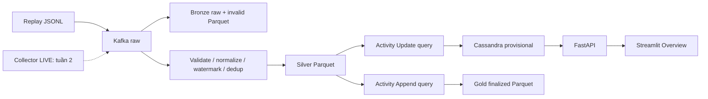

# Kiến trúc WikiPulse — CP0

Query độc lập/checkpoint riêng để không ghép nhiều stateful operators trong Update mode. Bronze giữ raw payload; Silver privacy-safe. Invalid và canary không đi vào activity. Cassandra ghi absolute counts/khóa ổn định; retry không cộng đôi. Gold chỉ lưu cửa sổ qua watermark10m, độ trễ khác provisional.

Docker core là local single-node, Spark local[2], 2 shuffle partitions, driver1GiB, Kafka heap512MiB, Cassandra heap512MiB. Dev stack có named volumes riêng. HDFS profile dự kiến hoàn thiện W2-TRONG-01; tuần 1 Parquet local là đường đã kiểm chứng. Kubernetes/monitor skeleton không phục vụ CP0.

Tham chiếu kỹ thuật: [Spark streaming/stateful restrictions](https://spark.apache.org/docs/3.5.6/structured-streaming-programming-guide.html#unsupported-operations), [Kafka Docker](https://kafka.apache.org/39/getting-started/docker/), [Cassandra query model](https://cassandra.apache.org/doc/latest/cassandra/developing/cql/dml.html).
