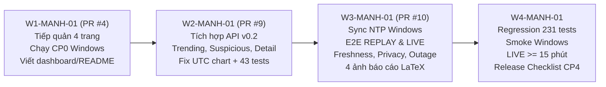
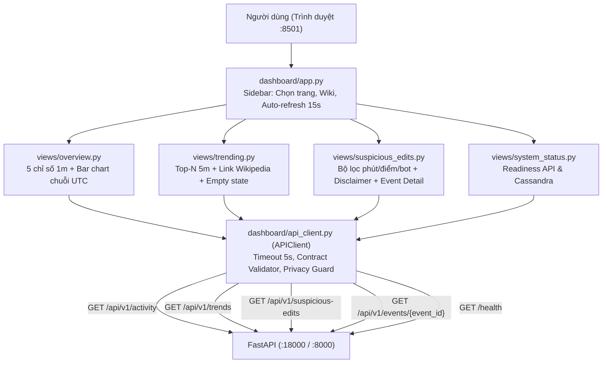

# Báo cáo tổng hợp Dashboard & QA — Mạnh (Tuần 1–4)

Tài liệu tổng hợp toàn bộ công việc triển khai module `dashboard/` và kiểm thử chấp nhận (QA / E2E) của **Mạnh** (`manhndgenius`) từ Tuần 1 đến Tuần 4, kèm sơ đồ luồng xử lý và bằng chứng kiểm chứng phục vụ review CP4.

## 1. Lộ trình 4 tuần & Các mốc bàn giao



| Tuần | Plan | Đầu ra chính | Trạng thái |
|---|---|---|---|
| Tuần 1 | [`W1-MANH-01`](../plans/W1-MANH-01.md) | Tiếp quản 4 trang Streamlit + `APIClient`, chạy lại CP0 trên Windows, viết `dashboard/README.md` | MERGED (PR #4) |
| Tuần 2 | [`W2-MANH-01`](../plans/W2-MANH-01.md) | Kết nối API thật cho Trending, Suspicious Edits, Event Detail theo contract v0.2; sửa lỗi múi giờ UTC trên biểu đồ Overview; cập nhật `dashboard/tests/` | MERGED (PR #9) |
| Tuần 3 | [`W3-MANH-01`](../plans/W3-MANH-01.md) | Đồng bộ NTP Windows (`BL-THANH-24`); E2E `REPLAY` và `LIVE`; đo freshness (`56.41s`); Privacy Audit; API Outage & Recovery; chèn 4 ảnh vào LaTeX (`BL-THANH-37`) | MERGED (PR #10) |
| Tuần 4 | [`W4-MANH-01`](../plans/W4-MANH-01.md) | Regression trên máy thứ hai (Windows 11); kiểm thử `LIVE` ít nhất 15 phút; hoàn thiện báo cáo & Release Checklist CP4 | REVIEW |

---

## 2. Kiến trúc module Dashboard & Kết nối API



### Điểm nhấn kỹ thuật đã triển khai
- **Sửa lỗi hiển thị UTC (`views/overview.py`):** Chuyển trục X của `st.bar_chart` sang chuỗi `YYYY-MM-DD HH:MM UTC` để Vega-Lite không tự quy đổi sang múi giờ trình duyệt (UTC+7).
- **Chức năng đầy đủ cho 4 trang (`W2-MANH-01`):**
  - `trending.py`: Chọn `limit` (10/20/50/100), liên kết mở thẳng bài viết Wikipedia, xử lý `window_start: null` khi rỗng, gắn nhãn `tạm tính`.
  - `suspicious_edits.py`: Lọc theo `minutes` (1–15), `min_score` (0–100), `limit`, checkbox ẩn/hiện bot edits, nút xem chi tiết sự kiện (`/api/v1/events/{event_id}`). Khi API trả phản hồi hợp lệ, kể cả danh sách rỗng, trang hiển thị disclaimer *"Điểm dùng để ưu tiên xem xét, không kết luận phá hoại."*
- **Kiểm soát contract & Privacy (`api_client.py`):** Client kiểm tra cấu trúc phản hồi theo từng endpoint. Riêng validator của suspicious edits và event detail từ chối `user_hash` và `comment` ở cấp trực tiếp của bản ghi; chúng không từ chối `username` hay `ip` theo cùng cách và không phải bộ quét đệ quy cho mọi endpoint. Việc validator chấp nhận trường không đồng nghĩa UI hiển thị trường đó.

---

## 3. Luồng xử lý dữ liệu, Privacy Guard & Phục hồi sự cố

```mermaid
sequenceDiagram
    participant UI as Streamlit UI
    participant Client as APIClient
    participant API as FastAPI

    UI->>Client: Gọi get_trends / get_suspicious_edits / get_event
    Client->>API: HTTP GET (timeout=5s)
    alt API trả về 200 OK
        API-->>Client: JSON (data, generated_at; provisional tùy endpoint)
        Client->>Client: Kiểm tra contract theo từng endpoint
        Note over Client: Suspicious và event detail từ chối user_hash, comment trực tiếp
        alt Dữ liệu hợp lệ và không rỗng
            Client-->>UI: state="ok" -> Render bảng/metrics
        else Dữ liệu rỗng (data=[])
            Client-->>UI: state="empty" -> Hiện thông báo chưa có dữ liệu
        else Dữ liệu sai contract
            Client-->>UI: state="error" -> Hiện thông báo lỗi
        end
    else Lỗi 503 CAPACITY_EXCEEDED
        API-->>Client: detail.code = CAPACITY_EXCEEDED
        Client-->>UI: state="error" -> Hướng dẫn thu hẹp bộ lọc (cap 5.000 dòng)
    else API hoặc Cassandra sập (Timeout / ConnectError / 503)
        Client-->>UI: state="unavailable" -> Báo lỗi rõ ràng, không bịa số 0
        Note over UI: Sau chu kỳ 15s hoặc bấm Làm mới, UI tự khôi phục khi API bật lại
    end
```

---

## 4. Bằng chứng kiểm thử & Release Checklist CP4 (Windows 11)

Bảng này giữ lại kết quả Mạnh ghi nhận trong các lần chạy trước; môi trường và kết quả chạy lại ngày 25/11/2026 được trình bày riêng ở mục 5.

| Hạng mục | Cách kiểm chứng | Kết quả quan sát |
|---|---|---|
| Lint toàn repo | `.venv\Scripts\ruff check .` | `All checks passed!` |
| Dashboard Unit & AppTest | `.venv\Scripts\python -m pytest dashboard/tests -q` | `43 passed` |
| Suite unit/contract được chọn | `.venv\Scripts\python -m pytest -q -m "not integration and not spark"` | `231 passed, 7 skipped, 67 deselected` |
| Compose Config (Core & HDFS) | `docker compose config -q` & `--profile full config -q` | Exit `0` |
| Đồng bộ giờ Windows (`BL-THANH-24`) | `w32tm /query /status` | `Leap Indicator: 0 (no warning)`, đồng bộ `time.windows.com` |
| E2E `REPLAY` (`SPARK_ANALYTICS_SINK=cassandra`) | `docker compose up -d api spark dashboard` + `replay` (11 events) | 4 trang đọc dữ liệu fixture qua Cassandra/API; ảnh lưu tại `docs/bao-cao-ky-thuat/hinh/W3-manh/` |
| Freshness `LIVE` | Đối chiếu `event_time` $\rightarrow$ `updated_at` do Spark gán và đọc qua API | Lượt đo trước của Mạnh ghi nhận **`56.41s`** (được gọi là event-to-Cassandra) và API freshness **`8.94s`**. `updated_at` không phải thời điểm Cassandra xác nhận ghi xong; đây là các giá trị quan sát, không đại diện cho phân phối độ trễ và cần lưu rõ cách tính khi so sánh. |
| Privacy Audit | Quét đệ quy JSON của `/activity`, `/trends`, `/suspicious-edits`, `/events/{id}` | Pass: 0 trường `user`, `username`, `user_hash`, `ip`, `comment`, `raw_payload` |
| API Outage & Recovery | `docker compose stop api` $\rightarrow$ AppTest 4 trang $\rightarrow$ `docker compose start api` | Outage: 4 trang báo lỗi rõ ràng, không crash; Recovery: tự khôi phục (`['238', '143', '2', '6', '74']`) |
| Kiểm thử `LIVE` $\ge$ 15 phút | `docker compose --profile live up -d api spark dashboard collector` | Báo cáo trước ghi `09:50:55Z` đến `10:08:04Z`, tương ứng **17 phút 09 giây**, và `enwiki` đạt `29`–`266` events/phút. Plan gốc có thêm mốc kết thúc khác nên chưa thể đối chiếu chính xác toàn bộ khoảng chạy; collector không có healthcheck để kết luận mọi container đều `healthy`. |
| Smoke script trên Windows | `.venv\Scripts\python scripts/smoke_test.py --hdfs --no-build` & `--no-build` | Lượt trước timeout tại `check_spark_ready` (180s) / `inspect_lake` (120s). Tài nguyên Docker Desktop là một giả thuyết, chưa có bằng chứng xác nhận nguyên nhân. Kết quả chạy lại ở mục 5. |

### Checklist bàn giao CP4 theo ghi nhận trước của Mạnh
- [x] Suite unit/contract được chọn (`231 passed`, không gồm integration và Spark) và `ruff check .` sạch lỗi trong lượt trước.
- [x] Cả 4 trang Dashboard hoạt động với dữ liệu từ Cassandra ở hai chế độ `REPLAY` và `LIVE` theo ghi nhận trước; `REPLAY` dùng fixture.
- [x] Đã ghi nhận phiên `LIVE` kéo dài $\ge$ 15 phút; các mốc cụ thể cần đối chiếu như bảng trên.
- [x] Đã hoàn thiện tài liệu `dashboard/README.md`, 4 ảnh minh chứng trong báo cáo LaTeX (`chapters/04-phan-tich-thiet-ke.tex`, `05-kiem-thu-danh-gia.tex`), và đóng các backlog `BL-NHAN-02`, `BL-THANH-24`, `BL-THANH-37`.

---

## 5. Kết quả chạy lại ngày 25/11/2026

Lượt kiểm tra này dùng code ở commit `b4c7f57`, Python 3.12.7 và Docker Desktop trên Windows. Các stack được tạo bằng Compose project và volume riêng; không dùng lại dữ liệu của lượt trước. Những số dưới đây là kết quả mới, không thay thế nhật ký của Mạnh ở mục 4. Lệnh và chi tiết môi trường xem tại [plan tái kiểm chứng](../plans/thanh-dashboard-recheck.md).

| Nội dung | Kết quả chạy lại | Ý nghĩa và giới hạn |
|---|---|---|
| Dashboard tests | `43 passed` | Các unit test và AppTest trong `dashboard/tests` đạt trên môi trường này. |
| Suite unit/contract | `233 passed, 5 skipped, 67 deselected` | Chạy bộ được chọn với `not integration and not spark`; không phải toàn bộ test của project. Khác `231 passed, 7 skipped` ở lượt cũ, không tự suy ra nguyên nhân chỉ từ số lượng. |
| Lint và Compose config | Ruff đạt; cấu hình Compose mặc định và profile `full` hợp lệ | Kiểm tra cấu hình không thay thế việc chạy dịch vụ. |
| Smoke local và HDFS | Cả hai lượt đều `passed` | Lượt local build image từ code hiện tại; lượt HDFS dùng lại image đã build. Kết quả mới chứng minh hai lượt này chạy thành công, không xác định được nguyên nhân timeout ở máy/lượt trước. |
| REPLAY với Cassandra | API trả activity 2 dòng, trends 1 dòng, suspicious edits 3 dòng và có event detail; AppTest cả 4 trang không báo lỗi | Dùng fixture, `SPARK_ANALYTICS_SINK=cassandra`. Đây là dữ liệu thử, không phải thống kê LIVE. |
| API outage và recovery | Tắt API: 4 trang đều hiện lỗi, không có exception; bật API: 4 trang chạy lại không có lỗi | Mỗi lần dùng AppTest mới trong stack REPLAY; chưa kiểm tra cùng phiên trình duyệt tự phục hồi hay mọi kiểu lỗi Cassandra. |
| Đồng hồ hệ thống | `w32tm /query /status`: dịch vụ Windows Time chưa chạy; ba mẫu `stripchart` so với `time.windows.com`: offset khoảng `+1,440` đến `+1,444` giây | Đây chỉ là snapshot chênh lệch theo công cụ tại thời điểm đo; chưa chứng minh máy đang đồng bộ. Khi đối chiếu timestamp từ nhiều máy, sai lệch đồng hồ ảnh hưởng độ chính xác. |
| LIVE ít nhất 15 phút | Collector có mốc bắt đầu `14:15:54Z`, còn chạy ở mẫu cuối `14:31:19Z`: khoảng **15 phút 25 giây**. Snapshot bộ đếm gần nhất trong log tại lần đọc cuối: `35.243` received, `35.242` published, `0` parse errors, `0` publish failures, `0` reconnects | Bộ đếm cho toàn stream collector, không phải riêng `enwiki`; chênh lệch received/published tại một thời điểm không đủ để kết luận mất dữ liệu. Các trạng thái và bộ đếm được lấy theo mẫu, không loại trừ restart giữa các mẫu. |
| API và UI trong LIVE | Mẫu cuối: activity 17 dòng, trends 20 dòng, suspicious edits 20 dòng và có event detail; AppTest 4 trang không có exception hay lỗi | API và UI được kiểm tra tại các thời điểm lấy mẫu; không khẳng định 4 trang được giám sát liên tục suốt phiên. |
| Freshness của một suspicious edit LIVE | Một mẫu: `updated_at - event_time = 5,188s`; `generated_at - updated_at = 20,540s` | `updated_at` do Spark gán và được đọc qua API, không phải thời điểm Cassandra xác nhận ghi xong. Đây là chênh lệch timestamp của một bản ghi và thời điểm tạo phản hồi, không phải latency API/network, thời gian đến UI hay phân phối độ trễ. Đồng hồ chưa được xác nhận đồng bộ; không so sánh trực tiếp với `8,94s` ở mục 4 khi chưa biết cách tính cũ. |

**Phạm vi kiểm tra privacy:** Ở lượt REPLAY và mẫu LIVE, quét đệ quy bốn phản hồi API được lấy không thấy các tên trường `user`, `username`, `user_hash`, `ip`, `comment`, `raw_payload`. Đây là kiểm tra theo tên trường trên những phản hồi được lấy, không phải chứng minh mọi giá trị hoặc mọi phản hồi đều không có thông tin định danh. Kiểm tra riêng bằng payload tổng hợp cho thấy hai validator suspicious edits/event detail từ chối `user_hash`, `comment` trực tiếp, nhưng chấp nhận `username`, `ip`; điều này tự nó không chứng minh UI hiển thị các trường đó.

Lượt chạy lại chưa kiểm thử Cassandra outage, thao tác nút event detail trên UI, phiên trình duyệt thực tế hoặc chụp lại ảnh. Event detail ở bảng trên được xác nhận qua API.
