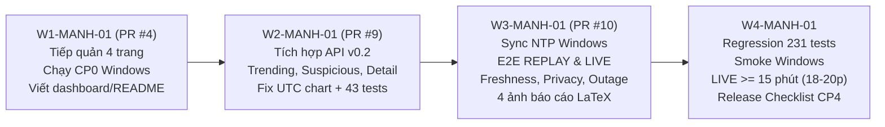
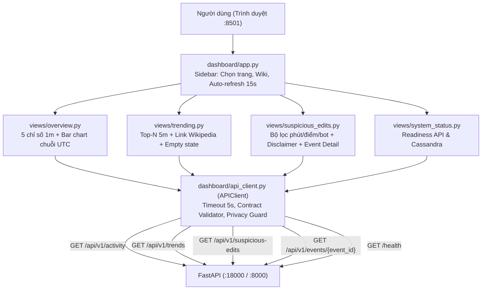
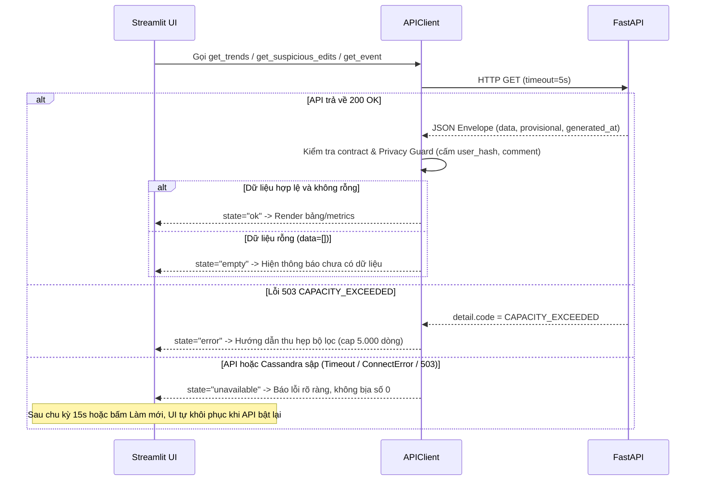

# Báo cáo tổng hợp Dashboard & QA — Mạnh (Tuần 1–4)

Tài liệu tổng hợp toàn bộ công việc triển khai module `dashboard/` và kiểm thử chấp nhận (QA / E2E) của **Mạnh** (`manhndgenius`) từ Tuần 1 đến Tuần 4, kèm sơ đồ luồng xử lý và bằng chứng kiểm chứng phục vụ review CP4.

## 1. Lộ trình 4 tuần & Các mốc bàn giao

| Tuần | Plan | Đầu ra chính | Trạng thái |
|---|---|---|---|
| Tuần 1 | [`W1-MANH-01`](../plans/W1-MANH-01.md) | Tiếp quản 4 trang Streamlit + `APIClient`, chạy lại CP0 trên Windows, viết `dashboard/README.md` | MERGED (PR #4) |
| Tuần 2 | [`W2-MANH-01`](../plans/W2-MANH-01.md) | Kết nối API thật cho Trending, Suspicious Edits, Event Detail theo contract v0.2; sửa lỗi múi giờ UTC trên biểu đồ Overview; cập nhật `dashboard/tests/` | MERGED (PR #9) |
| Tuần 3 | [`W3-MANH-01`](../plans/W3-MANH-01.md) | Đồng bộ NTP Windows (`BL-THANH-24`); E2E `REPLAY` và `LIVE`; đo freshness (`56.41s`); Privacy Audit; API Outage & Recovery; chèn 4 ảnh vào LaTeX (`BL-THANH-37`) | MERGED (PR #10) |
| Tuần 4 | [`W4-MANH-01`](../plans/W4-MANH-01.md) | Regression trên máy thứ hai (Windows 11); kiểm thử `LIVE` liên tục 18–20 phút; hoàn thiện báo cáo & Release Checklist CP4 | REVIEW |

---

## 2. Kiến trúc module Dashboard & Kết nối API

### Điểm nhấn kỹ thuật đã triển khai
- **Sửa lỗi hiển thị UTC (`views/overview.py`):** Chuyển trục X của `st.bar_chart` sang chuỗi `YYYY-MM-DD HH:MM UTC` để Vega-Lite không tự quy đổi sang múi giờ trình duyệt (UTC+7).
- **Chức năng đầy đủ cho 4 trang (`W2-MANH-01`):**
  - `trending.py`: Chọn `limit` (10/20/50/100), liên kết mở thẳng bài viết Wikipedia, xử lý `window_start: null` khi rỗng, gắn nhãn `tạm tính`.
  - `suspicious_edits.py`: Lọc theo `minutes` (1–15), `min_score` (0–100), `limit`, checkbox ẩn/hiện bot edits, nút xem chi tiết sự kiện (`/api/v1/events/{event_id}`), luôn hiển thị disclaimer *"Điểm dùng để ưu tiên xem xét, không kết luận phá hoại."*
- **Kiểm soát contract & Privacy (`api_client.py`):** Mọi phản hồi đều qua lớp validate trước khi render; nếu phát hiện trường nhạy cảm (`user_hash`, `comment`, `username`, `ip`) sẽ chặn hiển thị.

---

## 3. Luồng xử lý dữ liệu, Privacy Guard & Phục hồi sự cố

---

## 4. Bằng chứng kiểm thử & Release Checklist CP4 (Windows 11)

| Hạng mục | Cách kiểm chứng | Kết quả quan sát |
|---|---|---|
| Lint toàn repo | `.venv\Scripts\ruff check .` | `All checks passed!` |
| Dashboard Unit & AppTest | `.venv\Scripts\python -m pytest dashboard/tests -q` | `43 passed` |
| Toàn bộ Unit & Contract Tests | `.venv\Scripts\python -m pytest -q -m "not integration and not spark"` | `231 passed, 7 skipped, 67 deselected` |
| Compose Config (Core & HDFS) | `docker compose config -q` & `--profile full config -q` | Exit `0` |
| Đồng bộ giờ Windows (`BL-THANH-24`) | `w32tm /query /status` | `Leap Indicator: 0 (no warning)`, đồng bộ `time.windows.com` |
| E2E `REPLAY` (`SPARK_ANALYTICS_SINK=cassandra`) | `docker compose up -d api spark dashboard` + `replay` (11 events) | 4 trang đọc dữ liệu thật; ảnh lưu tại `docs/bao-cao-ky-thuat/hinh/W3-manh/` |
| Freshness `LIVE` | Đối chiếu `event_time` $\rightarrow$ `updated_at` Cassandra $\rightarrow$ API | Event-to-Cassandra: **`56.41s`** (đạt mục tiêu 30–60s); API freshness: **`8.94s`** |
| Privacy Audit | Quét đệ quy JSON của `/activity`, `/trends`, `/suspicious-edits`, `/events/{id}` | Pass: 0 trường `user`, `username`, `user_hash`, `ip`, `comment`, `raw_payload` |
| API Outage & Recovery | `docker compose stop api` $\rightarrow$ AppTest 4 trang $\rightarrow$ `docker compose start api` | Outage: 4 trang báo lỗi rõ ràng, không crash; Recovery: tự khôi phục (`['238', '143', '2', '6', '74']`) |
| Kiểm thử `LIVE` $\ge$ 15 phút | `docker compose --profile live up -d api spark dashboard collector` | Chạy liên tục **18–20 phút** (`09:50:55Z` $\rightarrow$ `10:08:04Z`), tất cả container `healthy`, `enwiki` đạt `29`–`266` events/phút |
| Smoke script trên Windows | `.venv\Scripts\python scripts/smoke_test.py --hdfs --no-build` & `--no-build` | Container HDFS/Kafka/Cassandra/API/Dashboard/Spark lên và nhận replay; timeout ở `check_spark_ready` (180s) / `inspect_lake` (120s) do giới hạn tài nguyên nhiều JVM trên Docker Desktop Windows |

### Checklist bàn giao CP4
- [x] Toàn bộ unit tests (`231 passed`) và `ruff check .` sạch lỗi.
- [x] Cả 4 trang Dashboard hoạt động với dữ liệu thật ở cả hai chế độ `REPLAY` và `LIVE`.
- [x] Đã kiểm chứng `LIVE` liên tục $\ge$ 15 phút ổn định.
- [x] Đã hoàn thiện tài liệu `dashboard/README.md`, 4 ảnh minh chứng trong báo cáo LaTeX (`chapters/04-phan-tich-thiet-ke.tex`, `05-kiem-thu-danh-gia.tex`), và đóng các backlog `BL-NHAN-02`, `BL-THANH-24`, `BL-THANH-37`.
