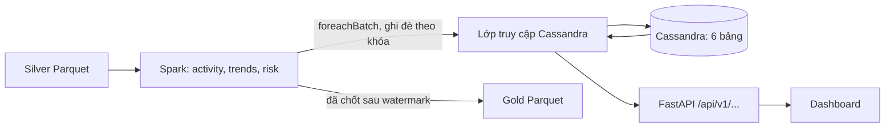

# Cassandra, sink và API WikiPulse: báo cáo công việc của Nhân từ W1 đến W4

## 1. Kết quả chính

Phần serving nhận kết quả Spark, lưu vào Cassandra và trả qua API cho dashboard. Đến hết W4, phần này làm được những việc sau mà không cần người can thiệp:

- **Bốn nghiệp vụ đều có dữ liệu thật qua API:** hoạt động theo wiki/phút, trang xu hướng, chỉnh sửa cần ưu tiên xem xét và chi tiết một sự kiện. Không endpoint nào còn trả 501, và không có dữ liệu giả hay seed.
- **Trên dữ liệu mẫu, mọi số API trả về khớp bộ kỳ vọng viết tay.** Bộ kỳ vọng này độc lập với code (xem mục 5.2).
- **Retry không làm sai số.** Spark ghi lại một batch thì Cassandra ghi đè đúng các khóa cũ, không đếm đôi.
- **Hệ thống tự báo lỗi, không trả kết quả sai.** Lỗi được báo theo bốn trường hợp:
  - Cassandra không trả lời → 503;
  - phải đọc quá 5.000 dòng → 503 `CAPACITY_EXCEEDED`, không trả bảng xếp hạng bị cắt;
  - tham số sai → 422, chỉ rõ tham số nào sai;
  - dòng từ Spark sai contract → batch thất bại để Spark chạy lại, không ghi số sai.
- **Lệch contract bị test chặn.** Đổi API hoặc cột lưu trữ mà không cập nhật contract thì test hồi quy fail.

Việc còn phụ thuộc người khác:
- Mặc định Compose vẫn cho Spark ghi xu hướng, chỉnh sửa đáng ngờ và chi tiết sự kiện ra Parquet. Vì vậy trên stack mặc định, ba endpoint này trả rỗng; muốn có dữ liệu phải đặt `SPARK_ANALYTICS_SINK=cassandra` (BL-NHAN-01, Trọng).
- Trang Trending và Suspicious trên dashboard chưa đọc API mới (BL-NHAN-02, Mạnh).

## 2. Phạm vi và luồng dữ liệu

Nhân sở hữu ba phần:
- lược đồ Cassandra và bước khởi tạo;
- lớp truy cập Cassandra, được Spark dùng để ghi và API dùng để đọc;
- FastAPI.

Ngoài phạm vi: tính toán trong Spark (Linh), giao diện (Mạnh), Compose và smoke (Trọng), nguồn dữ liệu (Thành).

Số trong Cassandra là **tạm tính**: cửa sổ còn mở thì số còn tăng khi có sự kiện đến muộn. Số **đã chốt** nằm ở Gold, sau khi watermark 10 phút đi qua. Mọi phản hồi dữ liệu của API vì vậy có `provisional: true`.

## 3. Công việc từ W1 đến W4

| Tuần | Phần Nhân thực hiện | Đầu ra |
|---|---|---|
| **W1** | Tiếp quản lược đồ, sink và API activity. Kiểm từng dòng trước khi ghi. Công bố lỗi 503 trong OpenAPI. Thêm test trên Cassandra thật. Sửa hai lỗi chỉ gặp trên Windows. Chạy lại CP0 trên Windows. Khởi tạo báo cáo LaTeX. | PR #1. [Plan W1](../plans/W1-NHAN-01.md) |
| **W2** | Chốt contract v0.2 với Linh và Mạnh. Thêm 5 bảng, 3 hàm ghi (đúng giao diện Spark của Linh gọi) và 3 hàm đọc. Thêm 3 endpoint. Thống nhất định dạng lỗi. | PR #3 (contract), PR #6. [Plan W2](../plans/W2-NHAN-01.md) |
| **W3** | Kiểm retry, cửa sổ mới nhất, chi tiết sự kiện và giới hạn 5.000 dòng trên node thật. Đo dung lượng, chốt hạn lưu 7 ngày cho chi tiết sự kiện. | PR #6 (dùng chung bộ test với W2). [Plan W3](../plans/W3-NHAN-01.md) |
| **W4** | Không thêm tính năng. Thêm snapshot OpenAPI, 4 test hồi quy contract, runbook vận hành. Tìm nguyên nhân 2 test deployment fail trên Windows. | PR #7. [Plan W4](../plans/W4-NHAN-01.md) |

## 4. Thiết kế

### 4.1. Bảng và khóa

Mỗi câu hỏi của API được trả lời bằng cách đọc **một partition**. Không truy vấn nào dùng `ALLOW FILTERING`.

| Bảng | Khóa | Phục vụ câu hỏi |
|---|---|---|
| `wiki_activity_by_window` | `((wiki), window_start)` giảm dần | Các phút mới nhất, hoặc một phút cụ thể, của một wiki |
| `page_trends_by_window` | `((wiki, window_start), page_key)` | Top-N trang trong một cửa sổ 5 phút |
| `trend_windows_by_wiki` | `((wiki), window_start)` giảm dần | Cửa sổ xu hướng mới nhất của wiki là cửa sổ nào |
| `suspicious_edits_by_bucket` | `((wiki, bucket_start), event_id)` | Các chỉnh sửa có điểm > 0 trong một phút |
| `suspicious_buckets_by_wiki` | `((wiki), bucket_start)` giảm dần | Những phút gần đây có chỉnh sửa đáng chú ý |
| `events_by_id` (hạn lưu 7 ngày) | `(event_id)` | Chi tiết một sự kiện |

Chi tiết từng cột: [data dictionary](../data-dictionary.md), [contract](../contracts.md#tuần-2--trends-suspicious-edits-event-detail-v02), [lược đồ](../../storage/cassandra/schema.cql).

### 4.2. Đúng khi retry

- **Ghi giá trị tuyệt đối, không ghi phần cộng thêm.** Spark ghi tổng của cửa sổ, và mỗi lần ghi là ghi đè theo khóa ổn định. Chạy lại một batch chỉ thay đúng dòng cũ.
- **Điểm không nằm trong khóa.** Điểm xu hướng và điểm ưu tiên đổi theo từng batch. Nếu đưa điểm vào khóa, mỗi lần điểm đổi sẽ sinh thêm một dòng và dòng cũ vẫn còn. Vì vậy API đọc cả partition rồi tự sắp xếp.
- **Dữ liệu trước, chỉ mục sau.** Trong mỗi batch, dòng dữ liệu được ghi trước, dòng chỉ mục cửa sổ/phút ghi sau. Thấy cửa sổ trong chỉ mục thì chắc chắn dữ liệu đã có.
- **Kiểm từng dòng trước khi ghi.** Dòng có trường lạ (ví dụ định danh người dùng hay bình luận), cửa sổ xu hướng không đúng 5 phút, phút của chỉnh sửa không khớp thời điểm sự kiện, hoặc lý do ngoài 3 mã: cả batch thất bại để Spark chạy lại. Chỉ các trường Spark luôn điền mới bị kiểm bắt buộc, để trường được phép trống không làm luồng fail lặp lại.

### 4.3. API và lỗi

| Endpoint | Trả về |
|---|---|
| `/api/v1/activity` | Các phút mới nhất, hoặc một phút cụ thể |
| `/api/v1/trends` | Top-N của cửa sổ 5 phút mới nhất (hoặc cửa sổ chỉ định). Xếp theo điểm, hòa thì theo số chỉnh sửa, rồi theo mã trang |
| `/api/v1/suspicious-edits` | Chỉnh sửa trong 1–15 phút gần nhất, lọc theo điểm tối thiểu. Luôn kèm câu nhắc *"Điểm dùng để ưu tiên xem xét, không kết luận phá hoại."* |
| `/api/v1/events/{id}` | Chi tiết một sự kiện; không có thì 404 |

Mọi lỗi có cùng dạng `{"detail": {"code", "message", ...}}`:

| HTTP | Mã | Khi nào |
|---|---|---|
| 422 | `INVALID_QUERY` | Tham số sai; kèm danh sách tham số sai |
| 404 | `EVENT_NOT_FOUND` | Không có sự kiện |
| 503 | `DEPENDENCY_UNAVAILABLE` | Cassandra không trả lời |
| 503 | `CAPACITY_EXCEEDED` | Phải đọc quá 5.000 dòng |

Bản OpenAPI đầy đủ được lưu ở [`api/openapi.json`](../../api/openapi.json).

### 4.4. Riêng tư

API không trả username, IP, bình luận hay `user_hash`. Lớp truy cập từ chối mọi dòng có các trường này, nên chúng không thể vào Cassandra từ phía Spark.

## 5. Kiểm thử và kết quả

Các con số dưới đây thuộc những lượt chạy khác nhau. **Số test** đếm theo hàm test; **số dòng** đếm theo bản ghi trong Cassandra. Hai loại số này không cộng được với nhau.

### 5.1. Test tự động

| Lượt chạy | Test nhẹ | Test trên Cassandra thật |
|---|---|---|
| W1, 22/10/2026, `main` `f422959` | 121 passed (toàn repo); `api/tests` 33 passed | 4 passed |
| W2–W3, 23/11/2026, nhánh PR #6 | 179 passed | 8 passed |
| W4, 23/11/2026, nhánh PR #7 | 183 passed, gồm 4 test hồi quy contract | 8 passed |
| Hôm nay, 24/11/2026, `main` `7b31fe4` | 220 passed, 2 failed; `api/tests` 72 passed | (không chạy lại; code serving không đổi từ PR #7) |

- **Vì sao số test nhẹ tăng dần:** mỗi lượt chạy toàn repo, và các thành viên khác cũng thêm test vào giữa các lượt.
- **Hai test fail ở lượt hôm nay** là test deployment chỉ fail trên Windows. Nguyên nhân: test xóa biến `PROGRAMFILES`, nên Docker không tìm thấy plugin compose. Lỗi này không thuộc serving; đã ghi cách sửa ở BL-NHAN-03 cho Trọng.
- **Bộ test chia làm hai loại.**
  - Test nhẹ thay Cassandra bằng bản giả lập ở tầng driver. Bản giả lập vẫn giữ đúng cách ghi đè theo khóa, và bắt buộc mọi truy vấn phải chỉ rõ đủ khóa partition.
  - Test trên Cassandra thật dùng keyspace ngẫu nhiên và xóa sau khi chạy.

### 5.2. Chạy đầu cuối trên dữ liệu mẫu

Lượt chạy ngày 23/11/2026 dùng một compose project riêng, Spark ghi Cassandra, phát lại 11 bản ghi mẫu. Kết quả:

- **Truy vấn Spark:** cả 9 truy vấn đều chạy.
- **Cassandra:** lưu 7 chi tiết sự kiện, bằng số sự kiện Silver.
- **Xu hướng, cửa sổ 00:00–00:05:**
  - trang 10: 4 chỉnh sửa, 3 người sửa, 1.890 byte, điểm 0,12475;
  - trang 11: 1 chỉnh sửa, 1 người sửa, 5 byte, điểm 0,022625.
- **Chỉnh sửa cần ưu tiên:** điểm 30 (xóa nhiều nội dung), 20 (hoàn tác) và 10 (sửa ẩn danh).
- **Trường hợp biên:**
  - sự kiện không dính dấu hiệu nào có điểm 0 và danh sách lý do rỗng;
  - định danh không tồn tại trả 404.

Các số này trùng với bộ kỳ vọng Linh dùng để kiểm đầu ra Parquet. Nghĩa là cùng một kết quả đi qua được cả hai đường lưu. Smoke mặc định của Trọng (chế độ Parquet) cũng đạt sau khi sửa phần kiểm API.

### 5.3. Dung lượng và hạn lưu

Đo ngày 23/11/2026 trên Cassandra 4.1.8 một node, với dữ liệu tổng hợp đúng contract. Dùng [công cụ đo](../../storage/cassandra/measure_capacity.py), ghi qua chính lớp truy cập mà Spark dùng.

| Bảng | Dòng | Byte/dòng trên đĩa | Ghi tuần tự |
|---|---|---|---|
| Chi tiết sự kiện | 20.000 | 144,5 | 78 dòng/s |
| Xu hướng (một cửa sổ đúng bằng giới hạn) | 5.000 | 16,8 | 79 dòng/s |

- Lấy top-20 từ partition 5.000 dòng mất 156 ms.
- Hai wiki đang theo dõi phát khoảng 2,3 sự kiện/s (số của Thành ở W1), tức khoảng 200.000 sự kiện/ngày, khoảng 29 MB/ngày. Giữ 7 ngày tốn khoảng **200 MB**; vì vậy chọn hạn lưu 7 ngày.
- Tốc độ ghi gấp khoảng 34 lần lưu lượng hai wiki.
- Dữ liệu tổng hợp lặp nhiều nên nén tốt hơn dữ liệu thật. Số byte của bảng xu hướng không dùng để ước tính.

## 6. Giới hạn

- **Chưa đo trên LIVE.** Độ trễ, dung lượng thật và cửa sổ xu hướng lớn nhất trên luồng LIVE chưa được đo qua Cassandra.
- **Một node.** Không có bản sao dữ liệu, không có xác thực.
- **Không có giao dịch chung giữa Parquet và Cassandra.** Tính đúng dựa vào ghi đè theo khóa, không cam kết "đúng một lần" trên cả hai nơi.
- **Giới hạn 5.000 dòng/lần đọc.** Một cửa sổ xu hướng hơn 5.000 trang sẽ trả lỗi thay vì kết quả. Muốn vượt giới hạn phải đổi lược đồ (ví dụ lưu sẵn top-N), nằm ngoài MVP.
- **Chi tiết sự kiện chỉ giữ 7 ngày.** Lịch sử đầy đủ vẫn ở Bronze/Silver.
- **Ghi tuần tự từng dòng.** Đủ cho hai wiki; nếu theo dõi cả luồng toàn cầu thì nên ghi song song.

## 7. Tài liệu liên quan

- Plan: [W1](../plans/W1-NHAN-01.md) · [W2](../plans/W2-NHAN-01.md) · [W3](../plans/W3-NHAN-01.md) · [W4](../plans/W4-NHAN-01.md). Lệnh tái hiện và evidence đầy đủ nằm ở các plan này.
- Hướng dẫn vận hành và xử lý sự cố: [README API](../../api/README.md#runbook), [README Cassandra](../../storage/cassandra/README.md).
- Contract và từ điển dữ liệu: [contracts.md](../contracts.md), [data-dictionary.md](../data-dictionary.md).
- Báo cáo kỹ thuật chung: [main.tex](../bao-cao-ky-thuat/main.tex). Các mục lược đồ, API, use case, kết quả và dung lượng đã được cập nhật theo đúng các số trong file này.
