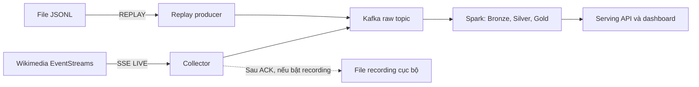
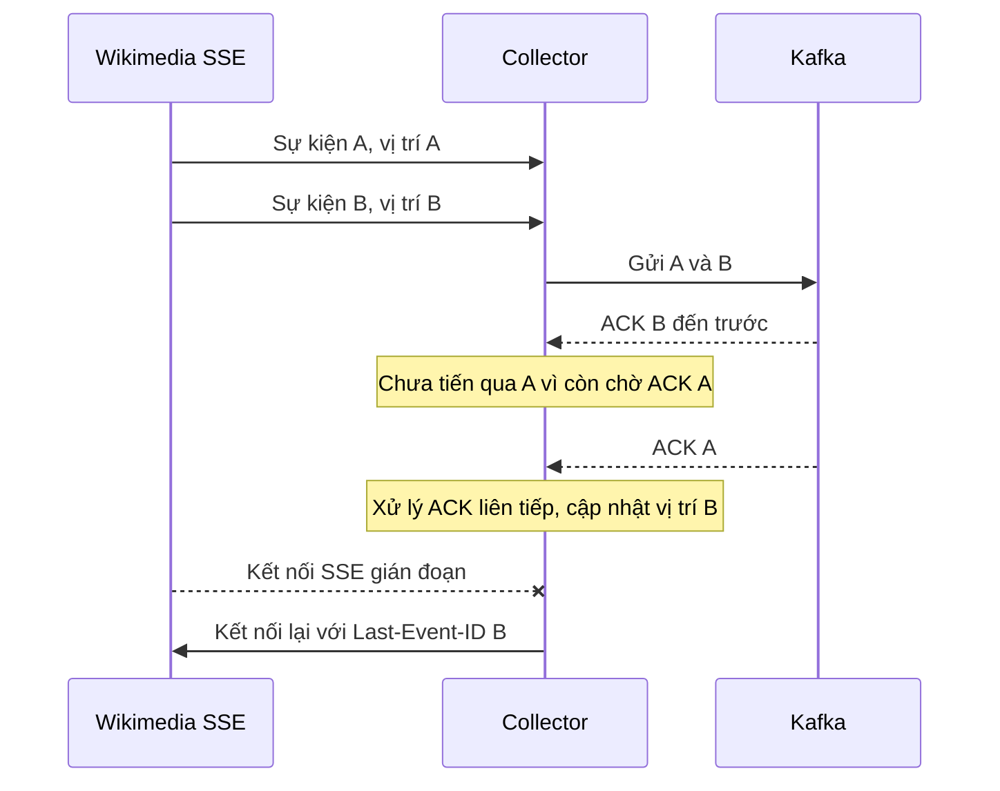

# Ingestion và replay WikiPulse: nội dung báo cáo W1–W4

## 1. Mục đích và phạm vi

Tài liệu này giúp Thành chuẩn bị nội dung cho báo cáo kỹ thuật WikiPulse: nguồn dữ liệu đến từ đâu, collector và replay đưa dữ liệu vào Kafka như thế nào, và những lần kiểm thử đã cho thấy điều gì. Nội dung tổng hợp dựa trên code và evidence W1–W4; các plan được dẫn link ở cuối bài là nơi lưu chi tiết từng lần thực hiện.

Thành phụ trách phần nhận và phát lại sự kiện. Kafka làm điểm chuyển tiếp sang Spark do Linh phụ trách; phần phục vụ dữ liệu qua API, dashboard và hạ tầng chung thuộc các thành viên tương ứng. Một lần kiểm thử của Thành không tự chứng minh toàn bộ hệ thống hoặc checkpoint của nhóm đã hoàn thành.

## 2. Tổng quan luồng dữ liệu

Đường LIVE nhận sự kiện mới từ Wikimedia. Đường REPLAY phát lại file JSONL, thường gồm một giá trị JSON trên mỗi dòng; fixture kiểm thử cũng có thể cố ý chứa dòng sai. Cả hai dùng cùng bước đóng gói trước khi gửi vào Kafka. Recording là lựa chọn bổ sung của collector, giúp lưu một tập sự kiện để phát lại; đây là file cục bộ cần xử lý cẩn thận về quyền riêng tư. Những ô phía sau Kafka thể hiện các thành phần khác của hệ thống, không phải bằng chứng rằng mọi lượt LIVE đã đi đến dashboard.

## 3. Công việc từ W1 đến W4

**W1 — Nền tảng replay và khảo sát nguồn.** Thành tìm hiểu EventStreams, tiếp quản replay và quy tắc tạo key, tách bước đóng gói chung cho hai nguồn. Replay được bổ sung xử lý lỗi và mã thoát; fixture LIVE mẫu được thay định danh để dùng trong kiểm thử. Một lượt chạy lại CP0 trên máy Windows cung cấp evidence cá nhân cho CP1, chưa thay thế nghiệm thu CP1 của cả nhóm. Xem [plan W1](../plans/W1-THANH-01.md) và [spike EventStreams](ingestion-spike.md).

**W2 — Nguồn LIVE.** Collector đọc Server-Sent Events (SSE: luồng server gửi liên tục qua HTTP), đưa từng sự kiện qua envelope rồi gửi Kafka. Công việc gồm theo dõi ACK, kết nối lại, ghi counters và dừng có kiểm soát. Những quyết định giao tiếp liên nhóm tiếp tục theo [contract](../contracts.md#kafka--thành--linh) và [backlog](../backlog.md#cần-nhóm-quyết-định).

**W3 — Phát lại và phục hồi.** Replay có thêm lựa chọn giữ nhịp theo thời gian sự kiện; collector có recording cục bộ. Các bài thử riêng kiểm tra Kafka dừng/phục hồi, recording với Spark và khả năng Spark đọc kịp một lượng dữ liệu đã gửi.

**W4 — Ổn định và bàn giao.** Sửa lỗi timestamp cực trị có thể làm gián đoạn collector; chạy thử LIVE và smoke REPLAY trên máy EC2 tạm; ghi lại kết quả và hướng dẫn dọn môi trường. Lượt máy thứ hai dùng snapshot working tree, nên chưa phải kiểm chứng bằng clean clone.

## 4. Thiết kế và triển khai kỹ thuật

### 4.1. Dữ liệu đầu vào và envelope

Envelope ở đây là bước chuẩn bị nội dung và key trước khi gửi Kafka, được dùng chung bởi collector và replay. Với dòng JSON là object, code giữ ID và thời điểm gốc, thêm `ingested_at` để biết thời điểm đưa vào hệ thống và `collector_version` để nhận biết nguồn/phiên bản. Key ưu tiên `wiki:page_id`, nếu thiếu `page_id` thì dùng `wiki:title`; wiki hoặc title thiếu/rỗng được thay bằng `unknown`. Nhờ key theo trang, các sự kiện cùng key được Kafka định tuyến theo cùng partition trong cấu hình producer thông thường.

Dòng JSON sai hoặc không phải object vẫn được chuyển đi dưới dạng nội dung gốc, không có key; bước kiểm tra phía Spark quyết định cách phân loại sau đó. Điều này giúp giữ lại dữ liệu cần xem xét thay vì âm thầm bỏ mất. Định dạng dùng chung và các quyết định liên nhóm xem [contract Kafka](../contracts.md#kafka--thành--linh); cách tạo thực tế xem [envelope.py](../../ingestion/envelope.py).

### 4.2. Replay và thời gian sự kiện

Replay đọc file theo thứ tự dòng, bỏ qua dòng trống, đóng gói rồi gửi từng sự kiện; lần gửi lỗi đầu tiên làm lượt chạy dừng và báo vị trí lỗi. Mặc định, nhịp gửi theo khoảng nghỉ cố định. Khi chọn `original`, chương trình ưu tiên thời gian `meta.dt` có múi giờ, sau đó thử `timestamp` dạng epoch giây; khoảng chờ giữa các mốc tăng được chia cho hệ số tốc độ.

Ví dụ, hai sự kiện cách nhau 10 giây theo nguồn tạo khoảng chờ 5 giây nếu tốc độ là 2; thời gian xử lý và gửi có thể làm khoảng cách thực tế dài hơn. Thời gian thiếu hoặc không tăng không làm mốc tham chiếu lùi lại; code không tạo khoảng nghỉ âm. Replay giữ ID và thời gian nguồn, không biến việc phát nhanh hơn thành việc sửa lịch sử. Chi tiết ở [replay producer](../../replay/replay_producer.py) và [README replay](../../replay/README.md).

### 4.3. Collector LIVE và SSE

Collector kết nối HTTP tới EventStreams bằng User-Agent mô tả, đọc các trường của SSE và đưa `data` vào bước đóng gói. Một luồng đọc riêng giúp tiến trình tiếp tục kiểm tra xác nhận Kafka hoặc phản ứng khi cần dừng ngay cả lúc nguồn đang im lặng. Collector ghi các bộ đếm theo tiến trình để người vận hành thấy số sự kiện nhận, số đã được xác nhận và các lỗi/kết nối lại.

Khi kết nối gián đoạn, collector thử lại với khoảng chờ tăng dần có thêm một lượng ngẫu nhiên nhỏ, tối đa 60 giây. Lỗi HTTP 4xx thông thường được coi là lỗi cần can thiệp, riêng 408 và 429 được thử lại. Khi dừng, collector ngừng nhận mới và chờ các xác nhận đang xử lý trong giới hạn cho phép. Chi tiết và giới hạn vận hành ở [README collector](../../ingestion/collector/README.md).

### 4.4. Kafka ACK, reconnect và resume

ACK là tín hiệu Kafka xác nhận một lần gửi. Các lần gửi có thể hoàn tất không theo thứ tự đã nhận, nên collector giữ hàng chờ theo thứ tự và chỉ cập nhật vị trí có thể nối lại sau chuỗi sự kiện liên tiếp đã được xác nhận. Nếu sự kiện đầu hàng chờ chưa được xác nhận, xác nhận của sự kiện phía sau chưa đủ để tiến vị trí qua sự kiện đó.

Sơ đồ giả định cả hai sự kiện đều có SSE ID và cùng tiến trình còn sống. Nếu ACK lỗi hoặc kết nối bị gián đoạn, sự kiện đã gửi gần điểm lỗi có thể được gửi lại. Collector chỉ giữ vị trí trong bộ nhớ; khi tiến trình restart, nó bắt đầu từ stream hiện tại. Nguồn cũng có thể không còn giữ vị trí yêu cầu. Vì vậy cơ chế này không đủ để cam kết không mất dữ liệu hoặc exactly-once.

### 4.5. Recording dự phòng và quyền riêng tư

Nếu bật recording, collector chuẩn bị một bản sao chọn lọc rồi chỉ ghi sau khi sự kiện tương ứng nằm trong chuỗi ACK liên tiếp; JSON lỗi hoặc không phải object bị bỏ khỏi recording. User được thay bằng mã giả ổn định trong một lượt ghi; comment nguồn bị loại và chỉ có thể được thay bằng nhãn `Reverted` khi khớp mẫu hoàn tác. Một số trường như title, ID và metadata được giữ lại.

Mã giả không đồng nghĩa với ẩn danh hoàn toàn: title hoặc metadata vẫn có thể chứa danh tính. Vì vậy recording được giới hạn ở thư mục local dành riêng, không commit nguyên trạng; dữ liệu cần được Thành xử lý và kiểm tra trước khi chia sẻ. File có thể thiếu sự kiện không hợp lệ nên không phải bản sao đầy đủ của raw stream. Luồng LIVE vào Kafka và Bronze raw vẫn giữ payload nguồn và có thể chứa user hoặc IP; cách xử lý recording không áp dụng cho luồng raw. Xem [recording.py](../../ingestion/collector/app/recording.py) và [README collector](../../ingestion/collector/README.md).

## 5. Kiểm thử và phân tích kết quả

Các kết quả dưới đây thuộc các lượt thử khác nhau, không phải một bài đánh giá hiệu năng chung. `received`, `published`, offset Kafka và số dòng Spark đo những việc khác nhau; không nên coi chúng tự động tương đương với số sự kiện duy nhất đã tới dashboard. Offset là vị trí của bản ghi trong một partition, tức một phần của topic Kafka; end-offset là vị trí cuối được ghi nhận của partition đó.

### W1 — Hiểu nguồn và kiểm chứng nền tảng

Trong lần khảo sát EventStreams khoảng 30 phút, tốc độ quan sát trên toàn stream khoảng **29,3 sự kiện/giây** và kích thước trung bình khoảng **1.340 byte/sự kiện**. Nhân hai con số cho khoảng 39 KB/giây; nếu giả định tải và kích thước không đổi suốt 24 giờ thì tương đương khoảng **3,4 GB/ngày** dữ liệu nội dung. Đây là phép ngoại suy để hình dung dung lượng raw, không phải mức dùng ổ đĩa đã đo: lưu lượng thay đổi và Kafka/Parquet, replication, metadata hoặc nén đều có thể làm dung lượng thực tế khác đi. Một mẫu 30 phút cũng không đủ để kết luận tải đỉnh hay công suất của Spark. Nguồn: [spike W1](ingestion-spike.md#lưu-lượng).

Lượt kiểm chứng cá nhân trên Windows với fixture CP0 ghi nhận **11 bản ghi Bronze raw, 2 invalid, 7 Silver và 2 Gold**, smoke pass; bộ Spark ở lượt đó có **16 test pass**. Bronze raw là tập bản ghi đầu vào, còn invalid là nhánh phân loại, nên không cộng 11 và 2 để tính tổng số bản ghi. Số Silver/Gold phản ánh các bước xử lý và cách fixture được thiết kế, không phải tỷ lệ chất lượng của dữ liệu Wikipedia ngoài thực tế. Lượt này giúp xác nhận pipeline mẫu hoạt động trong điều kiện thử, chưa thay nghiệm thu CP1 của cả nhóm. Nguồn: [evidence W1](../plans/W1-THANH-01.md#kết-quả).

### W2 — Collector LIVE và reconnect

Collector chạy khoảng **20 phút 45 giây**, ghi `received=40.112`, `published=40.112`, `publish_failed=0`, `parse_errors=0`, `reconnects=6` và không restart container. Trong lượt thử, mạng của collector được chủ động ngắt **75 giây**; sau khi nối lại, số ACK tiếp tục tăng. Xem [evidence W2](../plans/W2-THANH-01.md#kết-quả).

`received` là số event collector đưa vào bước publish; `published` là số ACK thành công đã được xử lý theo thứ tự liên tiếp trong tiến trình. Hai số cuối lượt bằng nhau và lỗi bằng 0 cho thấy collector đã ghi nhận xác nhận cho các event mà nó đếm trong lần chạy này. Việc counter tăng sau ngắt mạng cho thấy nó đã tiếp tục hoạt động sau gián đoạn; **6 reconnect** không có nghĩa cả sáu lần đều do thử nghiệm chủ động. Các counter không chứng minh nguồn đã phát bao nhiêu event trong lúc mất kết nối, không kiểm tra ID duy nhất đầu-cuối và không chứng minh mọi dữ liệu đã tới Spark hay dashboard.

### W3 — Outage và Spark bắt kịp

Trong bài thử Kafka outage cô lập, collector xử lý **4 ID duy nhất**, chương trình đọc Kafka nhận **4 bản ghi** và không thấy bản trùng trong tập đó. Kafka được dừng rồi khởi động lại, có hai sự kiện chờ xác nhận trong lúc gián đoạn, và phép đọc đi tới end-offset đã chốt. Kết quả giúp kiểm tra một đường phục hồi cụ thể; cỡ mẫu bốn sự kiện và một cách gây lỗi không đủ để ước lượng tỷ lệ mất/trùng trong vận hành. Nguồn: [evidence W3](../plans/W3-THANH-01.md#kết-quả).

Ở bài đo riêng, Spark được dừng, producer gửi **1.200 sự kiện tổng hợp** và chờ ACK, rồi Spark được khởi động lại. Ba query, tức ba tác vụ xử lý luồng, `bronze_raw`, `bronze_invalid`, `silver_events` đều báo end-offset đầu vào đạt đích khi test quan sát tại **8,984 giây** tính từ sau khi gửi xong; thời gian này bao gồm khởi động lại Spark và bước thăm dò tiến độ mỗi hai giây, không phải thời điểm chính xác từng query hoàn tất hay độ trễ của từng sự kiện. Các event dùng cùng key nên dồn vào một partition. Điều đó cho thấy ba query đang hoạt động đã báo đọc tới vị trí đích trong lần thử này. Nó **không** có nghĩa cả 1.200 sự kiện đều hợp lệ, đều nằm ở Silver, đã được chốt ở Gold hay xuất hiện trên dashboard sau 8,984 giây. Đây không phải phép đo độ trễ end-to-end, tốc độ xử lý bền vững hay khả năng mở rộng nhiều partition; Linh chưa phối hợp xác nhận phép đo.

Một bài test khác đưa recording tổng hợp qua replay rồi kiểm tra parser/analytics Spark; suite Spark ghi nhận **68 test pass**. Smoke HDFS ghi nhận **11 Bronze raw, 2 invalid, 7 Silver** và **9 checkpoint phục hồi**; checkpoint là trạng thái được lưu để tác vụ có thể tiếp tục sau khi khởi động lại. Những kết quả này kiểm tra các tình huống và fixture đã chọn, không thay cho việc chứng minh LIVE xuyên suốt đến API. Nguồn: [evidence W3](../plans/W3-THANH-01.md#kết-quả).

### W4 — Máy thứ hai và regression sau tích hợp

Trên EC2, collector chạy khoảng **30 phút 44 giây**; counter cuối là **70.252 received**, **70.252 published**, **parse_errors=0**, **publish_failed=0**, **5 reconnect**, không restart và dừng exit 0. `parse_errors` đếm JSON sai hoặc không phải object, không kiểm tra đầy đủ schema nghiệp vụ; hai counter lỗi bằng 0 cũng không chứng minh các thành phần khác không lỗi. Tổng end-offset Kafka được ghi nhận là **70.252** trong project thử. Counter và offset cùng giá trị là bằng chứng hữu ích về lượt chạy cô lập này, nhưng tổng offset là vị trí cuối theo partition, không tự đối chiếu ID duy nhất hay chứng minh không mất/trùng end-to-end. Sau đó tài nguyên AWS của lượt thử đã được dọn. Nguồn: [evidence W4](../plans/W4-THANH-01.md#kết-quả).

Smoke REPLAY core trên máy đó đạt **8 kiểm tra**; lượt này không chạy tùy chọn HDFS. Snapshot gồm code từ working tree chưa commit tại thời điểm tạo, không phải clean clone từ một commit. Kafka được dừng rồi khởi động lại 15 giây nhưng không phát sinh `publish_failed`, vì vậy kết quả đó chưa kiểm chứng được nhánh xử lý publish failure.

Sau khi tích hợp các thay đổi mới từ `main`, bộ regression chọn `not integration and not spark` đạt **224 passed, 5 skipped, 67 deselected**. “Skipped” là test được chọn nhưng bỏ qua theo điều kiện; “deselected” là test bị bộ lọc loại khỏi lượt chạy. Không được cộng các con số này thành số test đã pass hay diễn giải đây là toàn bộ test của dự án. Ruff và kiểm tra diff cũng đạt trong lượt đó. Xem [nhật ký W4](../plans/W4-THANH-01.md#nhật-ký).

## 6. Giới hạn và hướng phát triển

- **Vị trí nối lại:** cursor của LIVE chỉ tồn tại trong tiến trình. Có thể nghiên cứu lưu cursor bền vững, nhưng cần xem lại cách phối hợp với ACK và khả năng nguồn còn giữ vị trí đó.
- **Trùng, thiếu và dữ liệu đến muộn:** reconnect có thể gửi lại event; thời gian gián đoạn dài có thể ảnh hưởng đến xử lý theo watermark, tức mốc Spark dùng để quyết định cách xử lý dữ liệu đến muộn. Delivery và các phương án xử lý vẫn cần nhóm thống nhất trong [backlog](../backlog.md#cần-nhóm-quyết-định).
- **Quyền riêng tư:** raw LIVE có thể chứa user/IP; recording đã thay user vẫn có thể lộ qua title/metadata. Chỉ dùng dữ liệu tổng hợp hoặc đã xử lý phù hợp khi đưa ví dụ vào báo cáo.
- **Khả năng tái hiện:** lượt EC2 dùng snapshot working tree; script evidence cục bộ không nằm trong Git. Muốn kết luận về clean clone hoặc toàn bộ demo, cần một lượt kiểm chứng phù hợp điều kiện nghiệm thu chung.
- **Phối hợp:** phép đo Spark cần Linh xem xét; việc demo LIVE/REPLAY và review contract cần các thành viên liên quan xác nhận. Trạng thái cập nhật nằm ở [checkpoints](../checkpoints.md); không suy ra CP3/CP4 hoàn thành chỉ từ số liệu cá nhân.

## 7. Gợi ý bổ sung vào báo cáo chung

Các mục dưới đây là gợi ý cho Thành và Nhân khi cập nhật [báo cáo LaTeX](../bao-cao-ky-thuat/main.tex); tên phần dựa trên cấu trúc hiện có. Nội dung cần được chủ sở hữu báo cáo đối chiếu với phiên bản mới trước khi đưa vào.

| Phần trong báo cáo chung | Nội dung có thể sử dụng từ tài liệu này |
|---|---|
| **Luồng sự kiện thay đổi của Wikipedia** trong chương cơ sở lý thuyết | Giải thích SSE, kết nối lại, ý nghĩa `Last-Event-ID` và giới hạn của resume ở mục 4.3–4.4. |
| **Kiến trúc tổng quan** và **Đường đi của một sự kiện** | Cập nhật hai nguồn LIVE/REPLAY, Kafka và ranh giới với Spark/serving dựa trên sơ đồ mục 2. |
| **Thu thập dữ liệu → Kafka / Phát lại dữ liệu mẫu / Thu thập luồng thật** | Mô tả envelope, key, replay timing, collector và recording ở mục 4; kiểm tra lại dấu đánh dấu phần chưa viết hiện có. |
| **Kiểm thử và đánh giá → Khởi động lại, retry và dữ liệu đến muộn / Chạy LIVE liên tục** | Chọn các kết quả phù hợp từ mục 5, giữ rõ điều kiện đo và phần chưa được chứng minh. |
| **Kết luận và hướng phát triển** | Đưa các hạn chế và hướng phối hợp ở mục 6 vào đúng ngữ cảnh của báo cáo chung. |

Một số đoạn LaTeX hiện vẫn ghi collector LIVE là công việc dự kiến hoặc phần chưa viết. Đây là điểm cần cập nhật nội dung, không đồng nghĩa mọi checkpoint của nhóm đã đạt.

## 8. Tài liệu tham khảo

- [Plan W1](../plans/W1-THANH-01.md), [plan W2](../plans/W2-THANH-01.md), [plan W3](../plans/W3-THANH-01.md), [plan W4](../plans/W4-THANH-01.md): nhật ký, lệnh và evidence của từng tuần.
- [Spike EventStreams](ingestion-spike.md): phương pháp khảo sát, quan sát nguồn và giới hạn mẫu W1.
- [Contract](../contracts.md), [checkpoints](../checkpoints.md) và [backlog](../backlog.md): quy ước, trạng thái và các quyết định cần nhóm phối hợp.
- [Code collector](../../ingestion/collector/app/collector.py), [SSE parser](../../ingestion/collector/app/sse.py), [recording](../../ingestion/collector/app/recording.py), [envelope](../../ingestion/envelope.py) và [replay](../../replay/replay_producer.py): cách triển khai thực tế.
- [README collector](../../ingestion/collector/README.md) và [README replay](../../replay/README.md): cách dùng, vận hành và giới hạn module.
