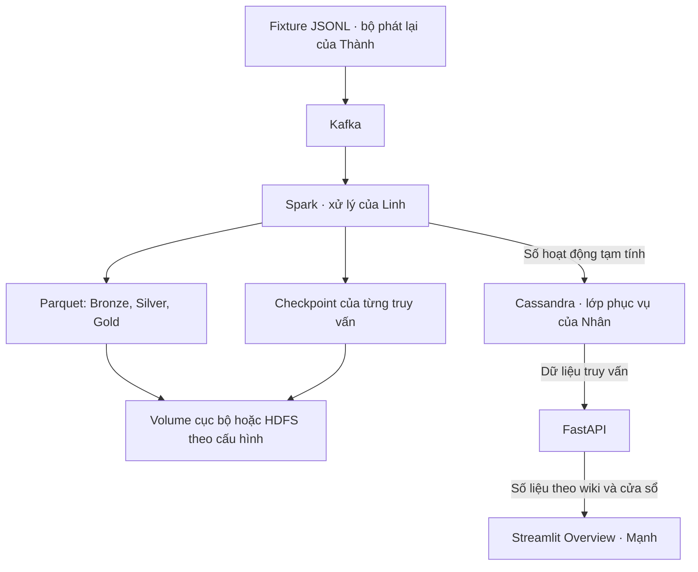
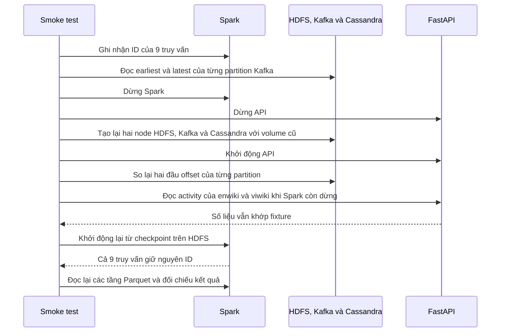

# Hạ tầng và tích hợp WikiPulse — báo cáo công việc của Trọng từ W1 đến W4

## 1. Mục đích và phạm vi

Trọng phụ trách khung dự án, môi trường chạy chung và kiểm thử tích hợp. Trong bốn tuần, Trọng cùng nhóm trả lời ba câu hỏi. Một sự kiện phát lại có đi tới đúng số liệu trên Overview không? Khi tạo lại container, dữ liệu và vị trí xử lý có còn không? Từ một bản sao mã nguồn mới, có tái hiện được buổi demo không? Báo cáo đối chiếu hồ sơ trên `main` tại `a691238` ngày 23/11/2026. Kết quả mỗi tuần gắn với phiên bản đã chạy thử trong tuần đó. [Kế hoạch và phân công](../../plans.md) · [Bảng nghiệm thu](../checkpoints.md)

## 2. Tổng quan luồng tích hợp

Sơ đồ thể hiện đường REPLAY mà Trọng dùng để nghiệm thu. Ở W1, Spark ghi các tệp Parquet và trạng thái xử lý vào volume cục bộ. Từ W2, profile `full` khởi động HDFS và tệp Compose bổ sung chuyển cả dữ liệu lẫn checkpoint của Spark sang hệ thống tệp này. Trong cả hai cấu hình, người xem Overview đọc số liệu hoạt động qua FastAPI. [Kiến trúc](../architecture.md) · [Cấu hình HDFS](../../storage/hdfs/README.md)

Điểm nối quan trọng là hai đầu ra của Spark. Cassandra phục vụ số tạm tính khi cửa sổ còn nhận sự kiện đến muộn. Gold lưu kết quả đã chốt khi watermark, tức mốc tiến độ theo thời gian sự kiện, đi qua cuối cửa sổ. Vì vậy bài kiểm thử phải quan sát cả số trên Overview lẫn dữ liệu Gold. [Contract dữ liệu](../contracts.md) · [Fixture activity và số liệu kỳ vọng](../../tests/fixtures/expected_activity.json)

## 3. Công việc từ W1 đến W4

| Tuần | Phần Trọng thực hiện | Đầu ra bàn giao |
|---|---|---|
| **W1 — Dựng khung** | Tổ chức monorepo và phân công module, viết contract v0.1, ghép Compose, cấu hình môi trường, bước khởi tạo topic và schema Cassandra. | Bộ lệnh Makefile và smoke test chạy REPLAY từ fixture đến Overview. Các owner có một luồng activity hoạt động để tiếp quản. [Nhật ký CP0](implementation-log.md) |
| **W2 — Tích hợp HDFS** | Ghép đầu ra phân tích của Linh vào môi trường chung, bổ sung profile HDFS và phép kiểm tra dịch vụ sẵn sàng nhận việc. | Hai lượt tích hợp trên ARM64 trong cùng phiên, một lượt dùng volume cục bộ và một lượt dùng HDFS. [Plan W2](../plans/W2-TRONG-01.md) |
| **W3 — Kiểm tra phục hồi** | Mở rộng smoke để kiểm chứng cả Kafka, Cassandra và HDFS qua lần tạo lại container. Đưa bộ kiểm thử của Linh vào Makefile, thêm cấu hình monitoring và khung Kubernetes. | Hai bài thử riêng cho độ bền dữ liệu và tính đúng nghiệp vụ khi khởi động lại. [Plan W3](../plans/W3-TRONG-01.md) |
| **W4 — Chuẩn bị demo** | Sửa phép thử Compose dùng tệp môi trường cho tương thích nhiều hệ điều hành, giới hạn các test mô phỏng Bash vào môi trường phù hợp và chạy lại từ clone sạch. | Ứng viên demo REPLAY/HDFS tại `ce71442`, có các bước đối chiếu Overview, System Status và kết quả phục hồi. [Plan W4](../plans/W4-TRONG-01.md) |

## 4. Thiết kế và triển khai kỹ thuật

### 4.1. Tách từng lượt thử để biết số liệu đến từ đâu

Mỗi lượt smoke có Compose project, cổng, volume và mã lần chạy riêng. Producer phát fixture vào Kafka thật. Bộ kiểm thử so kết quả với tệp kỳ vọng viết sẵn và chạy Streamlit AppTest ngay trong image dashboard, gọi API của chính stack vừa dựng. Nếu pipeline ghi đúng Cassandra nhưng Overview chọn nhầm cửa sổ, phép kiểm ở giao diện vẫn phát hiện được. Cách này từng giúp xác minh việc chọn đúng cửa sổ khi API ghi giờ UTC dưới dạng `Z` còn fixture dùng `+00:00`. [Hồ sơ CP0](verification.md) · [Bộ kiểm thử tích hợp](../../scripts/smoke_test.py)

### 4.2. Xác định lúc HDFS và Spark thực sự sẵn sàng

NameNode quản lý thông tin về tệp, còn DataNode lưu các khối dữ liệu. Trong mạng Compose, có lúc NameNode đã trả lời nhưng DataNode chưa đăng ký xong. Lượt smoke đầu tiên gặp lỗi vì mạng Compose thiếu phân giải DNS ngược. Trọng điều chỉnh riêng bước xác minh tên máy cho mạng demo. Trong cấu hình đã chạy đạt, NameNode phải thoát chế độ an toàn, DataNode phải đăng ký thành công và bước khởi tạo phải ghi rồi đọc lại được một khối thử trước khi Spark khởi động. NameNode chỉ format volume rỗng. Nếu volume có dữ liệu nhưng thiếu tệp nhận diện `current/VERSION`, quá trình khởi động dừng để người vận hành kiểm tra. [Khởi tạo HDFS](../../storage/hdfs/README.md) · [Nhật ký xử lý lỗi W2](../plans/W2-TRONG-01.md#nhật-ký)

Phía Spark, phép kiểm đọc bản cập nhật tiến độ của tiến trình điều phối. Cả chín truy vấn dự kiến phải đang hoạt động và bản cập nhật phải nằm trong 60 giây gần nhất. Một nguồn đang im lặng vẫn có thể đạt điều kiện này. Muốn biết sự kiện đã đến Overview, smoke phải phát fixture và đối chiếu số hiển thị. [Mã kiểm tra Spark](../../scripts/check_spark_ready.py)

### 4.3. Đọc Cassandra trước khi cho Spark chạy lại

Nếu Spark được bật ngay khi Cassandra trở lại, một dòng activity đúng có thể là dòng vừa được Spark ghi lại. Trọng sắp thứ tự phép thử để phân biệt hai trường hợp. Sơ đồ dưới đây dùng `earliest` và `latest` cho hai đầu của khoảng offset, tức khoảng vị trí bản ghi Kafka còn giữ trong mỗi partition. [Smoke HDFS](../../scripts/smoke_test.py) · [Kết quả W3](../plans/W3-TRONG-01.md#kết-quả)

### 4.4. Giám sát và phạm vi Kubernetes

Prometheus thu kết quả từ Blackbox Exporter mỗi 15 giây. Probe API gọi `/health` để kiểm tra cả kết nối Cassandra, còn probe dashboard gọi `/_stcore/health` để biết Streamlit có phản hồi. Trong bài thử HTTP cô lập, API trả 200 cho kết quả 1, dashboard trả 503 cho kết quả 0 và trở lại 1 khi phản hồi 200. Muốn đánh giá độ mới của số liệu, vẫn phải kiểm tra cửa sổ sự kiện đang hiển thị. [Monitoring](../../monitoring/README.md) · [Kết quả W3](../plans/W3-TRONG-01.md#kết-quả)

Trọng cũng chuẩn bị manifest Kubernetes cho lớp ứng dụng. Kustomize đã kết xuất được bảy tài nguyên, gồm cấu hình cho API, dashboard và collector với số replica bằng 0. Job khởi tạo Cassandra được kiểm tra riêng. Phép kiểm này chạy ngoại tuyến. Các bài thử có Kafka, Spark, HDFS và Cassandra thật trong báo cáo dùng Docker Compose. [Khung Kubernetes](../../deploy/kubernetes/README.md) · [Plan W3](../plans/W3-TRONG-01.md#kết-quả)

## 5. Kiểm thử và phân tích kết quả

**W1 — Từ 11 bản ghi đến đúng cửa sổ trên Overview.** Kafka nhận 11 bản ghi và Bronze raw lưu đủ 11. Có 2 bản ghi được phân loại invalid và 7 sự kiện đi tới Silver sau kiểm tra, lọc và loại trùng. Trong cửa sổ 00:00 UTC ngày 01/01/2026, Overview hiển thị 5 chỉnh sửa của `enwiki` (1 ẩn danh, 1 bot) và 1 trang mới của `viwiki`. Sự kiện lúc 00:12:10 đẩy watermark 10 phút qua cuối cửa sổ, khi đó Gold có 2 dòng activity, mỗi wiki một dòng. Con số 7 ở Silver tính trên cả fixture, còn bảng activity trên đếm riêng phút 00:00. Lượt CP0 cũng đạt 84 test nhẹ và 16 test Spark trong container. [Evidence CP0](verification.md#real-smoke)

**W2 — Cùng fixture trên hai cấu hình lưu trữ.** Cả hai lượt smoke core và HDFS đều đạt. Sau khi tạo lại NameNode và DataNode với các volume cũ, Spark khôi phục đủ 9 ID truy vấn. Lần đọc lại ghi nhận 11 bản ghi Bronze raw, 2 bản ghi thuộc nhánh invalid, 7 sự kiện Silver và 2 dòng Gold activity ở cửa sổ mục tiêu. Các đầu ra phân tích Parquet cũng khớp fixture, gồm 7 sự kiện chi tiết và 3 chỉnh sửa được gắn cờ để xem xét. Bộ test nhẹ đạt 145, bộ Spark đạt 66. [Evidence W2](../plans/W2-TRONG-01.md#kết-quả)

**W3 — Dữ liệu nào còn sau khi tạo lại container?** Trong bài thử ở mục 4.3, khoảng offset trên cả ba partition Kafka giữ nguyên và bao phủ 11 bản ghi. API đọc được đúng activity trước khi Spark chạy lại. Sau đó, chín truy vấn nhận lại đúng ID và các đầu ra Parquet khớp fixture. Trọng cũng kiểm tra chính sách lưu topic raw mới ở mức 24 giờ. Khi chạy lại bước khởi tạo với giá trị 48 giờ, broker vẫn báo 24 giờ cho topic đang có. [Evidence W3](../plans/W3-TRONG-01.md#kết-quả)

Một bài thử W3 khác dùng bộ dữ liệu và chương trình nghiệm thu của Linh. Cả **7/7 pha** đạt trên cấu hình HDFS chung. Bài thử chủ động gây lỗi sau khi Cassandra đã ghi, rồi cho Spark xử lý lại batch. Số chỉnh sửa của cửa sổ mục tiêu vẫn là 3. Gold chỉ xuất hiện sau khi sự kiện tiếp theo đẩy watermark qua cuối cửa sổ. Hai quan sát này kiểm tra hai rủi ro khác nhau trong cùng fixture, gồm đếm đôi khi ghi lại và chốt cửa sổ quá sớm. [Lượt tích hợp của Trọng](../plans/W3-TRONG-01.md#kết-quả) · [Fixture và kết quả của Linh](../plans/W3-LINH-01.md#kết-quả)

**W4 — Tái hiện ứng viên demo từ clone sạch.** Trọng checkout `ce71442` trong clone độc lập trên cùng máy macOS ARM64, tạo môi trường Python 3.12.5 mới rồi build bốn image. Kết quả gồm **147 test nhẹ**, **68 test Spark** và smoke REPLAY/HDFS đạt. Smoke vẫn đọc được activity khi Spark dừng và khôi phục đủ chín checkpoint. Đây là kết quả gắn với phiên bản ứng viên và môi trường đã ghi trong plan. [Evidence và kịch bản demo W4](../plans/W4-TRONG-01.md#kết-quả)

## 6. Giới hạn và phần còn chờ nghiệm thu

- **Độ bền dữ liệu.** HDFS demo có một NameNode, một DataNode và một bản sao mỗi khối. Bài thử tạo lại container giữ nguyên ổ lưu trữ. Mất volume hoặc mất cả máy là hai kịch bản cần kiểm chứng riêng. [Thiết kế HDFS](../../storage/hdfs/README.md)
- **Phạm vi LIVE và serving.** Sau bản `ce71442`, Thành đã chạy collector đến Kafka trên EC2 trong 30 phút 44 giây từ bản sao thư mục làm việc. Nhân cũng đã kiểm tra ba API xu hướng, chỉnh sửa đáng ngờ và chi tiết sự kiện với Cassandra. Đây là bằng chứng của từng module, cần ghép với kết quả hiển thị bốn trang khi nghiệm thu demo chung. [Lượt EC2 của Thành](../plans/W4-THANH-01.md#kết-quả) · [Kiểm thử serving của Nhân](../plans/W2-NHAN-01.md#kết-quả)
- **Điều kiện bàn giao.** Tại `a691238`, Trọng đã hoàn thành các đầu việc W1–W3. W4 của Trọng còn `BLOCKED`. Nhóm vẫn cần chạy clone sạch đúng SHA ứng viên trên máy thứ hai, hoàn tất nghiệm thu CP3 và xác nhận luồng LIVE ít nhất 15 phút cùng kết quả trên bốn trang dashboard. CP0 là cổng chung đã được đánh dấu `DONE`. [Checkpoints](../checkpoints.md) · [Plan bàn giao](../plans/W4-TRONG-01.md)

## 7. Gợi ý đưa vào báo cáo kỹ thuật chung

| Phần trong báo cáo chung | Nội dung có thể sử dụng |
|---|---|
| **Kiến trúc tổng quan → Triển khai** và **Cấu hình và tách lần chạy** | Dùng sơ đồ mục 2 và cách cô lập fixture ở mục 4.1 để giải thích đường đi tới Overview, vị trí lưu checkpoint và hai cấu hình lưu trữ. |
| **Kết quả CP0** và **Khởi động lại, retry và dữ liệu đến muộn** | Đưa số liệu cửa sổ 00:00 cạnh kết quả trên dashboard. Dùng sơ đồ mục 4.3 để giải thích vì sao cần đọc Cassandra trong lúc Spark dừng. |
| **Kết quả đạt được** và **Hạn chế** | Dùng kết quả W4 kèm SHA, loại máy và phạm vi REPLAY. Ghi rõ mức kiểm chứng của Kubernetes, monitoring và những điều kiện CP4 còn chờ. |

Các tên phần đối chiếu theo [bản LaTeX của nhóm](../bao-cao-ky-thuat/main.tex).

## 8. Tài liệu tham khảo

- Phân công và tiêu chí nghiệm thu nằm trong [kế hoạch bốn tuần](../../plans.md) và [checkpoints](../checkpoints.md).
- Quá trình dựng khung và kết quả REPLAY đầu tiên có trong [nhật ký triển khai](implementation-log.md) và [hồ sơ nghiệm thu CP0](verification.md).
- Lệnh tái hiện, môi trường và kết quả từng đợt được lưu trong [plan W2](../plans/W2-TRONG-01.md), [plan W3](../plans/W3-TRONG-01.md) và [plan W4](../plans/W4-TRONG-01.md).
